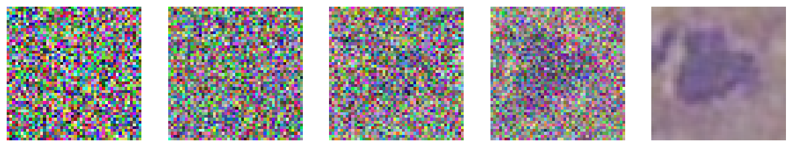
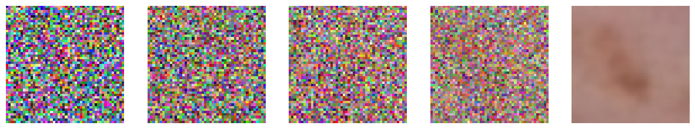
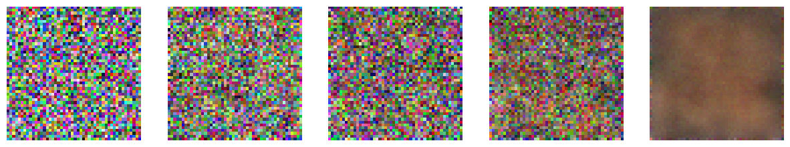

# MedMNIST Image Generation and Classification with DDPM

An ongoing research project exploring **Denoising Diffusion Probabilistic Models (DDPMs)** for biomedical image generation and **CNN-based classification** of original and synthetic images.

## Project objective

Generate biomedical images from MedMNIST datasets and investigate their visual quality and class-related characteristics using FID and downstream classification. BloodMNIST is the initial experiment, with extensions to DermaMNIST and RetinaMNIST.

## Workflow

1. Prepare original images using the dataset splits.
2. Train a DDPM and generate synthetic images.
3. Evaluate generation using Fréchet Inception Distance (FID).
4. Train CNNs with the same architecture separately on original and synthetic data.
5. Compare classification results and investigate differences.

Classification performance provides evidence about class-related information; it does not by itself establish visual equivalence, diversity, or clinical realism.

## Progress

| Dataset | Image generation | CNN classification |
| --- | --- | --- |
| BloodMNIST | Completed experiment | Original and synthetic experiments completed |
| DermaMNIST | Completed experiment | Planned |
| RetinaMNIST | Completed experiment | Planned |

This reflects the current project progress. Code and existing visual outputs are included; end-to-end reproduction has not been independently verified.

## Notebooks

| Notebook | Purpose |
| --- | --- |
| [BloodMNIST DDPM](notebooks/generation/bloodmnist_ddpm.ipynb) | Diffusion training, sampling, and FID evaluation |
| [DermaMNIST DDPM](notebooks/generation/dermamnist_ddpm.ipynb) | Diffusion training, sampling, and FID evaluation |
| [RetinaMNIST DDPM](notebooks/generation/retinamnist_ddpm.ipynb) | Diffusion training, sampling, and FID evaluation code |
| [Original-image CNN](notebooks/classification/bloodmnist_real_cnn.ipynb) | BloodMNIST classification using original images |
| [Synthetic-image CNN](notebooks/classification/bloodmnist_synthetic_cnn.ipynb) | BloodMNIST classification using an externally prepared synthetic dataset |

The two custom CNN experiments use the same architecture with separately trained weights. The original-image notebook also contains an exploratory VGG16 section.

## Generation examples

Existing sampling visualizations exported from the generation notebooks. These are sampling-progress displays, not class-labelled sample datasets or new runs.

### BloodMNIST



### DermaMNIST



### RetinaMNIST



## Evaluation

- **Generation:** FID evaluation code is included for all three datasets. Saved test-FID outputs are present for BloodMNIST and DermaMNIST; a saved RetinaMNIST test-FID value still needs to be consolidated.
- **Classification:** accuracy, precision, recall, F1-score, class reports, and confusion matrices are implemented for BloodMNIST. The summary precision/recall/F1 use micro averaging; class reports also show other averages.
- **Planned:** extend CNN evaluation to DermaMNIST and RetinaMNIST, add multiclass ROC-AUC reporting, and consolidate results under consistent protocols.

FID and CNN results should be interpreted with the image preprocessing, sample counts, labels, splits, and feature representation used in each experiment. No cross-dataset ranking is asserted here.

## Setup

The generation notebooks use **PyTorch, Lightning, MedMNIST, TorchMetrics, and torch-fidelity**. Classification uses **TensorFlow/Keras**. Development includes Google Colab and Kaggle paths.

Install dependencies in a compatible Python environment:

```bash
python -m pip install -r requirements.txt
python -m jupyter lab
```

For a lighter setup, use `requirements-generation.txt` or `requirements-classification.txt` separately. Versions are unpinned because the original environment lockfiles are unavailable. Graphviz must also be installed on the system if using Keras architecture plotting. Skip or adapt Colab-only imports outside Colab, update local paths, and use separate working directories for each experiment to avoid checkpoint-name collisions.

Original images are downloaded through MedMNIST. The synthetic classification notebook expects an external `.npz` containing `train_images`, `train_labels`, `val_images`, `val_labels`, `test_images`, and `test_labels`. That file, its label/export procedure, and trained checkpoints are not included.

**Execution notes:** the synthetic notebook contains a leftover cell referencing `train_dataset`, `val_dataset`, and `test_dataset`; its subsequent array-based preprocessing uses `train_images`, `val_images`, and `test_images`. 

## Next steps

- Add the synthetic-data export and label-assignment procedure.
- Consolidate checkpoints, split information, and metric exports.
- Complete DermaMNIST and RetinaMNIST classification.
- Evaluate real/synthetic transfer with fixed train/test protocols.


